# «Ихтисоси ман»: ҳамаи имкониятҳо

**Сайт:** https://ikhtisosiman.qobus.tj · **Санаи ҳолат:** 14.10.2026

Платформаи ройгон барои хонандагони синфҳои 9 ва 11-и Тоҷикистон, ки касб ва ихтисосро интихоб мекунанд. Лоиҳа ба се гурӯҳ кӯмак мекунад: **хонанда** худашро мешиносад ва касбро месанҷад, **волидайн** дар интихоб иштирок мекунанд, **омӯзгор** тамоми синфро мебинад ва ба ҳар хонанда кӯмак мекунад.

| Рақам | Чӣ |
|---|---|
| **884** | ихтисоси расмии ММТ-и Тоҷикистон |
| **128** | донишгоҳ ва коллеҷ дар харита |
| **23 307** | холи гузариши расмии солҳои 2021–2025 |
| **884** | сенарияи «Худро дар касб санҷед» (ҳар ихтисос 4 вазифаи худро дорад) |
| **102** | видеои омӯзишӣ (17 мавзӯъ × 3 забон × компютер ва телефон) |
| **3** | забон: тоҷикӣ, русӣ, англисӣ |

Скриншотҳо аз худи сайт гирифта шудаанд, бо ҳисобҳои намоишии синфи `NAMUNA`.

---

## Мундариҷа
1. [Хонанда: худшиносӣ ва интихоб](#1-хонанда-худшиносӣ-ва-интихоб)
2. [Хонанда: касбро аз наздик санҷидан](#2-хонанда-касбро-аз-наздик-санҷидан)
3. [Хонанда: аз интихоб то ҳуҷҷатсупорӣ](#3-хонанда-аз-интихоб-то-ҳуҷҷатсупорӣ)
4. [Волидайн](#4-волидайн)
5. [Омӯзгор ва мактаб](#5-омӯзгор-ва-мактаб)
6. [Барои ҳама: AI, овоз, видео](#6-барои-ҳама-ai-овоз-видео)
7. [Чаро ин лоиҳа фарқ дорад](#7-чаро-ин-лоиҳа-фарқ-дорад)

---

## 1. Хонанда: худшиносӣ ва интихоб

### 1.1. Саҳифаи асосӣ
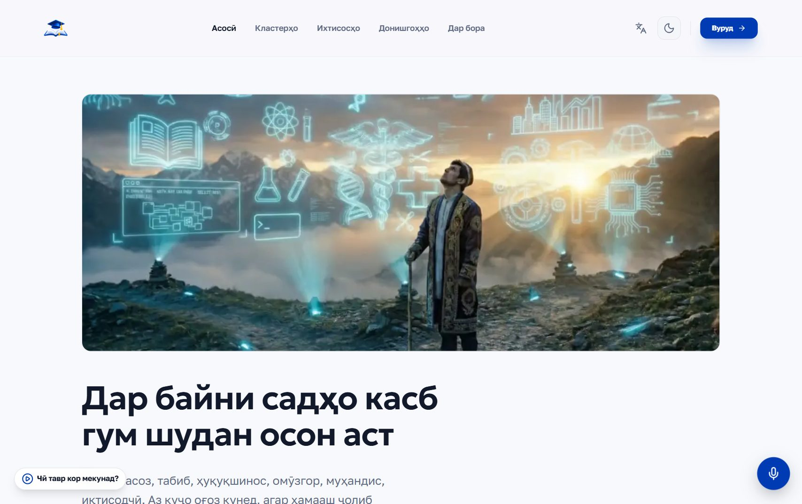

Аз саҳифаи асосӣ ба ҳамаи қисмҳо рафтан мумкин аст: тест, ихтисосҳо, панҷ самти ММТ, донишгоҳҳо, «Касб-свайп».

### 1.2. Тести касбинтихобкунӣ
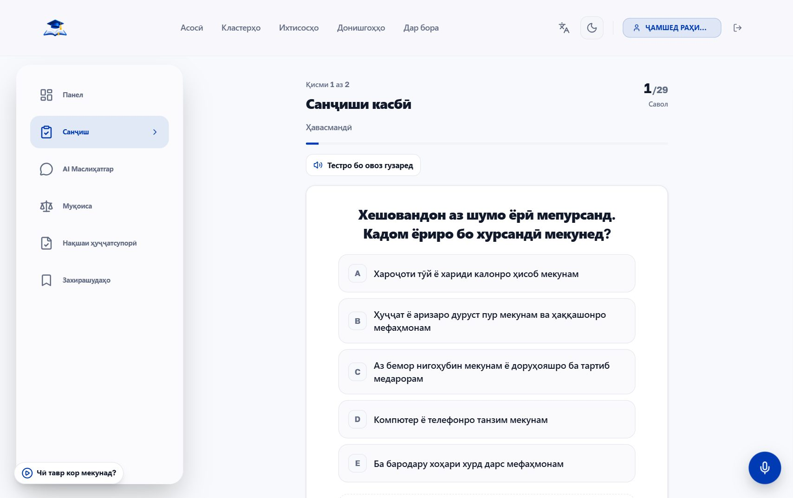

- **Ду қисм.** Қисми 1 самти ММТ-ро меёбад (аз 5 самт). Қисми 2 бо ҳамон самт мувофиқ мешавад ва ихтисосҳоро аниқтар интихоб мекунад.
- **Вазъиятҳои ҳаётӣ:** ҷавоби дуруст ё нодуруст нест.
- **«Ҷавоби шумо дар рӯйхат нест?»** Хонанда бо калимаҳои худ менависад ва AI варианти наздиктаринро пешниҳод мекунад.
- **Синф:** баъди синфи 9 танҳо коллеҷҳо, баъди синфи 11 коллеҷ ва донишгоҳ пешниҳод мешаванд.
- Тугмаҳои 1–5 дар клавиатура ҳам кор мекунанд.

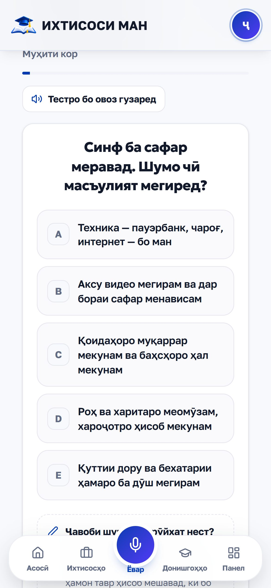

### 1.3. Реҷаи овозии тест (барои нобиноён ва камбиноён)
Тугмаи **«Тестро бо овоз гузаред»** (дар скриншоти болоӣ). Ҳар савол бо ҷавобҳо бо **овози модели тоҷикии худи лоиҳа** хонда мешавад ва микрофон худкор гӯш мекунад. Хонанда «якум», «дуюм» ё худи ҷавобро мегӯяд ва интихоб бо овоз тасдиқ мешавад: «Шумо интихоб кардед…».

### 1.4. Натиҷаи тест
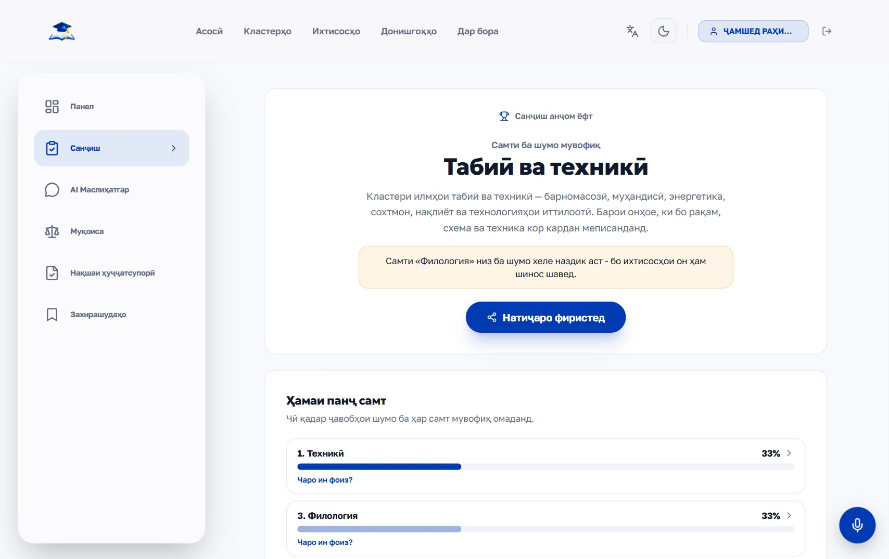

Самти мувофиқ бо тавсифи кӯтоҳ. Натиҷаро ба Telegram ё Instagram ҳамчун тасвир фиристодан мумкин аст.

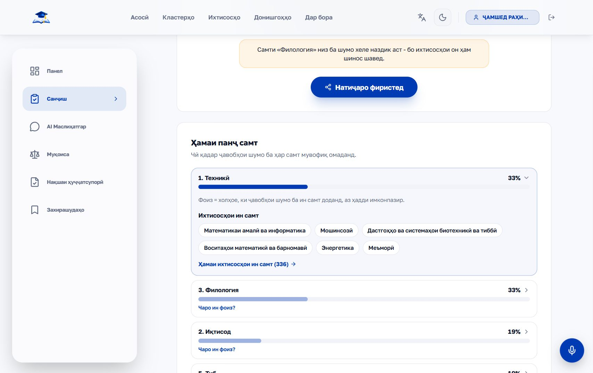

**«Ҳамаи панҷ самт»** бо фоиз. Тугмаи **«Чаро ин фоиз?»** нишон медиҳад, ки кадом ҷавобҳо фоизро доданд ва чӣ намерасид. Тест «қуттии сиёҳ» нест.

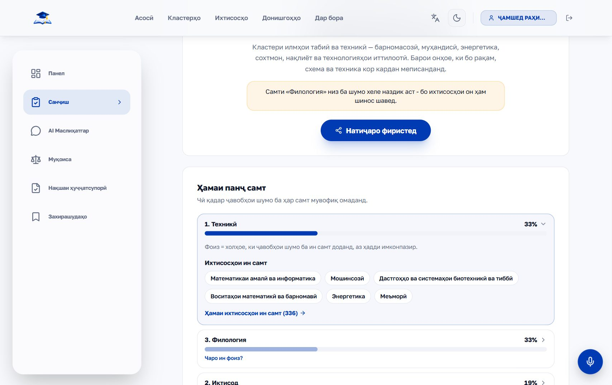

**12 ихтисоси мувофиқ**, аз фоизи баландтарин ба поён. Фоиз аз ду қисм иборат аст: нисфаш мувофиқати самт, нисфаш мувофиқат бо ҷавобҳо.

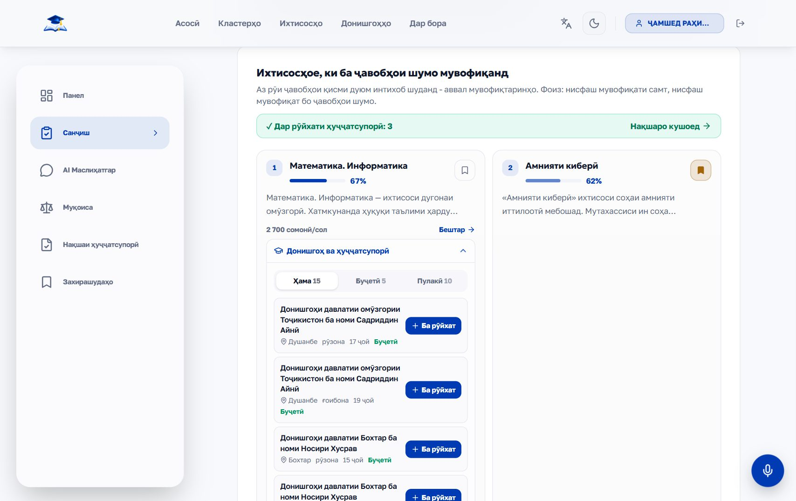

Зери ҳар ихтисос **донишгоҳҳо** бо филтри «Ҳама / Буҷетӣ / Пулакӣ» ҳастанд. Онҳоро бо як тугма ба рӯйхати ҳуҷҷатсупорӣ илова кардан мумкин аст.

### 1.5. «Касб-свайп»: бозии 1-дақиқаӣ

 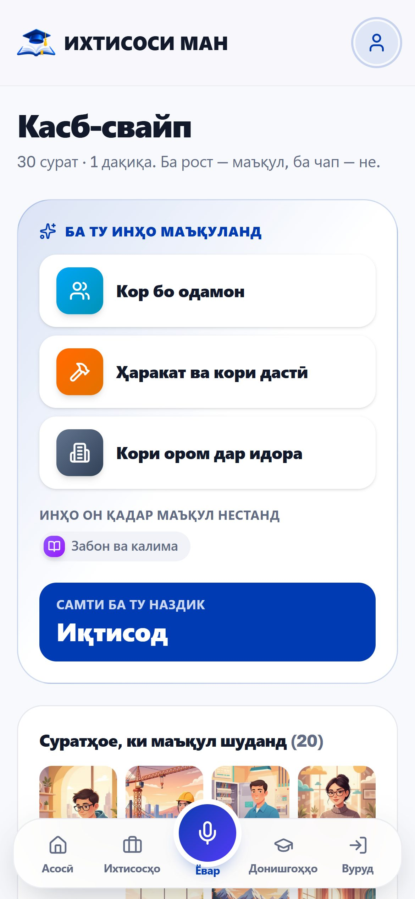

- **30 сурати кори воқеӣ** бо одамони тоҷик. Суратҳоро модели тасвирсози Gemini махсус барои лоиҳа кашидааст.
- Ангуштро ба рост (маъқул) ё ба чап (не) мекашед, мисли Tinder.
- Дар охир инҳо нишон дода мешаванд:
  - «Ба ту инҳо маъқуланд»: 3 хусусият, масалан кор бо одамон, ҳаракат ё кори ором;
  - «Инҳо он қадар маъқул нестанд»;
  - самти наздик ва 5 ихтисос аз база.
- Ин бозӣ аст, на ташхис; барои ҷавонон даромади осон ба тест.

### 1.6. «Дӯстон маро чӣ гуна мебинанд?» (360°)

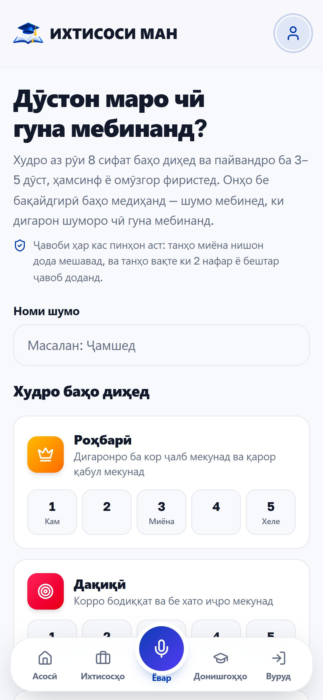

- Хонанда пайвандро ба 3–5 дӯст, ҳамсинф ё омӯзгор мефиристад. Онҳо бе бақайдгирӣ ӯро аз рӯи 8 сифат баҳо медиҳанд: роҳбарӣ, дақиқӣ, эҷодкорӣ, ғамхорӣ, мантиқ, сабр, далерӣ, муошират.
- Натиҷа инҳоро нишон медиҳад:
  - «Ман ↔ Дигарон»;
  - **сифатҳои пинҳон**: дигарон баландтар баҳо доданд;
  - **«фикри шумо баландтар аст»**;
  - самт ва ихтисосҳо.
- **Махфият:** ҷавоби ҳар дӯст алоҳида нишон дода намешавад. Натиҷа танҳо миёна аст ва танҳо аз 2 ҷавоб боло нишон дода мешавад.

---

## 2. Хонанда: касбро аз наздик санҷидан

### 2.1. Каталоги 884 ихтисос
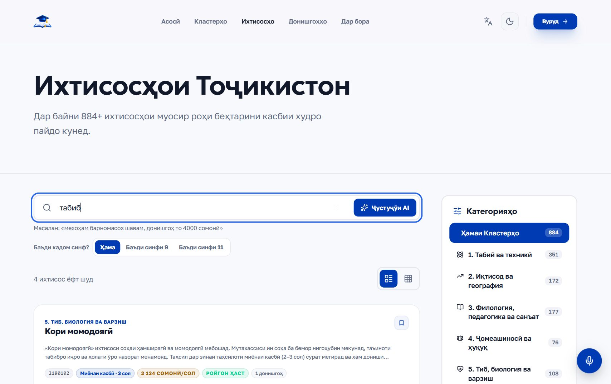

- **Ҷустуҷӯ** бо номи тоҷикӣ, русӣ ва англисӣ.
- **Ҷустуҷӯи AI:** хоҳишро бо калимаҳои оддӣ нависед, масалан «мехоҳам бо кӯдакон кор кунам».
- **Филтрҳо:** самт, шаҳр, нарх ва ҷойҳои буҷетӣ.

### 2.2. Саҳифаи ихтисос
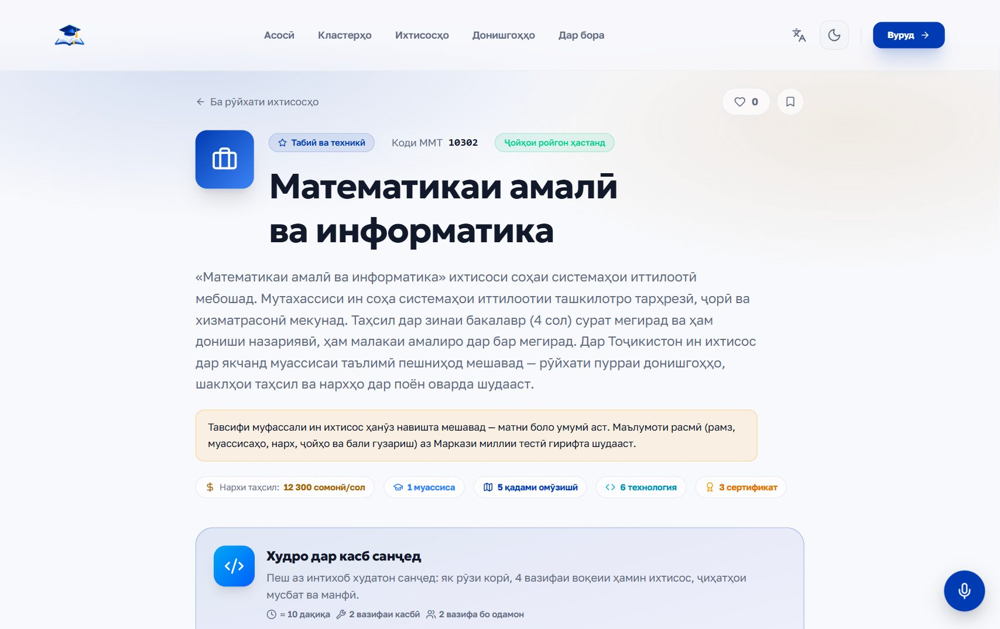

- Рамзи ММТ, самт, муддати таҳсил ва нарх.
- Рӯзи корӣ, хубиҳо ва душвориҳо.
- **Холҳои расмии гузариш** аз соли 2021 то 2025.
- Ҷадвали донишгоҳҳо бо ҷойҳои буҷетӣ ва пулакӣ.
- **Ёвари AI-и касб:** ба саволҳо дар бораи ҳамин касб ҷавоб медиҳад, бо овоз ҳам.

### 2.3. «Чаро шумо ин касбро мехоҳед?» (AI)
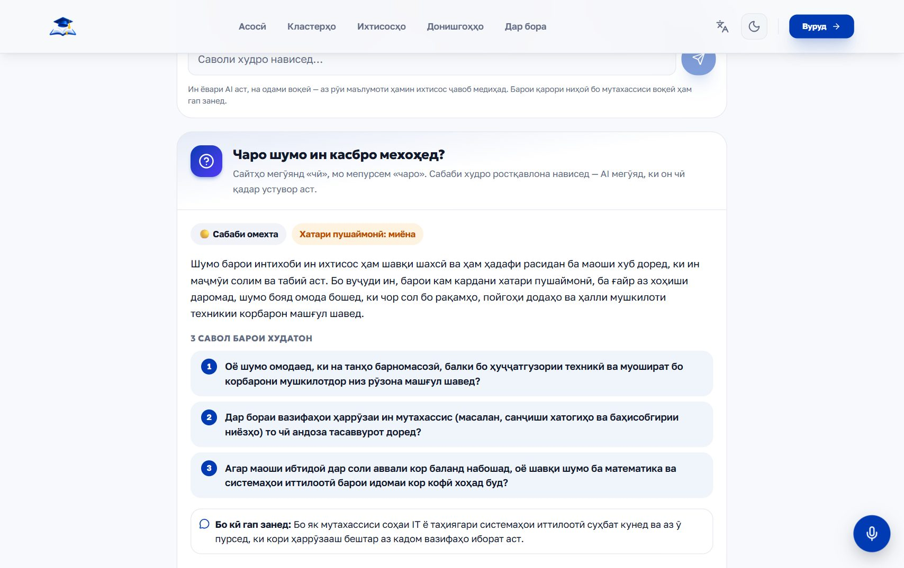

- Сайтҳо мегӯянд «чӣ», мо мепурсем «**чаро**».
- Хонанда сабаби худро менависад ё тугмаҳои тайёрро пахш мекунад, масалан «Маоши хуб», «Падару модарам мехоҳанд», «Шавқ дорам».
- AI ростқавлона баҳо медиҳад:
  - сабаб дохилӣ (шавқ, қобилият), омехта ё берунӣ (пул, обрӯ, фишор) аст;
  - **хатари пушаймонӣ**;
  - 3 саволе, ки бояд аз худ пурсад;
  - бо кӣ гап занад.
- Матни хонанда нигоҳ дошта намешавад.

### 2.4. «Ин касб дар соли 2035»
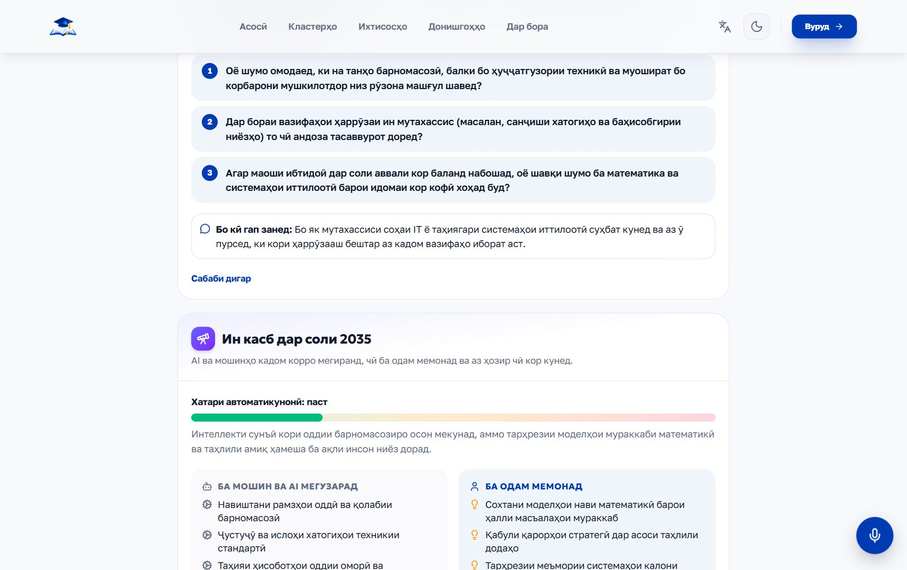

- **Хатари автоматикунонӣ**: паст, миёна ё баланд.
- Кадом корро мошин ва AI мегиранд ва кадом кор ба одам мемонад.
- Малакаҳои нав ва 3 қадам аз ҳозир.
- Пешгӯӣ як бор сохта ва кеш мешавад; бори дуюм фаврӣ кушода мешавад.

### 2.5. «Худро дар касб санҷед»
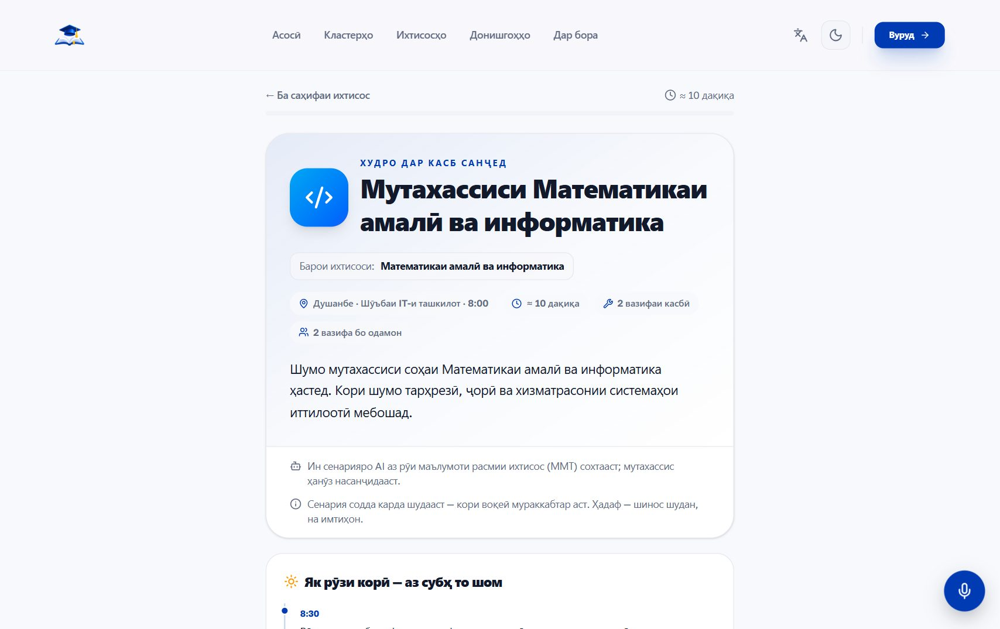
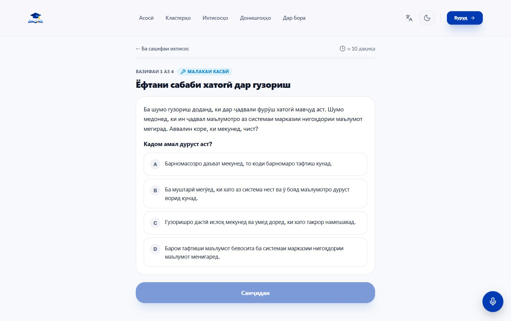

- **884 сенария:** ҳар ихтисос як рӯзи кории худро дорад ва 4 вазифа: 2 вазифаи касбӣ ва 2 вазифаи кор бо одамон. Тақрибан 10 дақиқа вақт мегирад.
- Пеш аз оғоз хонанда мегӯяд, ки ба касб чӣ қадар боварӣ дорад. Баъди санҷиш ҳамин савол такрор мешавад, ва ин «таъсир»-и воқеиро нишон медиҳад.
- Баъди ҳар вазифа инҳо нишон дода мешаванд:
  - чаро ҷавоб дуруст аст ва мутахассис чӣ тавр фикр мекунад;
  - ин малака дар кори воқеӣ дар куҷо лозим аст;
  - «ин кор писанд омад ё не?».
- Вазифаҳо барои хонанда содда ҳастанд: бе код, бе формула ва бе истилоҳҳои мураккаб.
- Пешрафт ҳафт рӯз нигоҳ дошта мешавад.

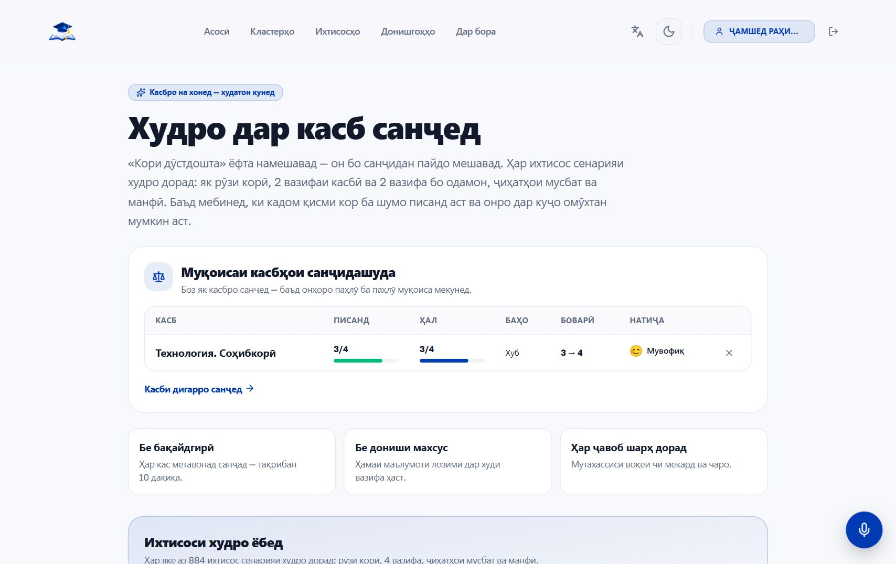

**Муқоисаи касбҳои санҷидашуда:** агар хонанда 2–3 касбро санҷида бошад, онҳо дар ҷадвал муқоиса мешаванд ва касби беҳтарин бо ⭐ ишора мешавад.

### 2.6. Донишгоҳҳо дар харита
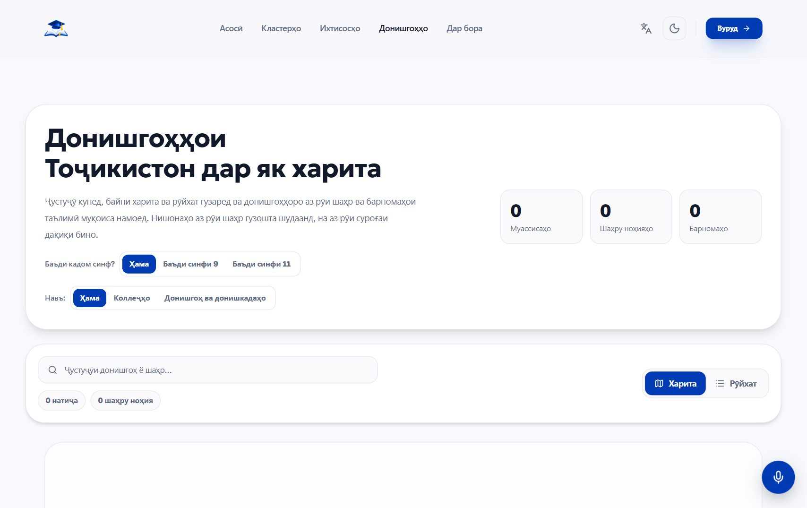

128 донишгоҳ ва коллеҷ дар харита ва дар рӯйхат. Ҷустуҷӯ аз рӯи шаҳр ва ном, филтр «коллеҷ ё донишгоҳ». Саҳифаи ҳар муассиса ихтисосҳо, нарх ва ҷойҳоро нишон медиҳад.

---

## 3. Хонанда: аз интихоб то ҳуҷҷатсупорӣ

### 3.1. Панели шахсӣ
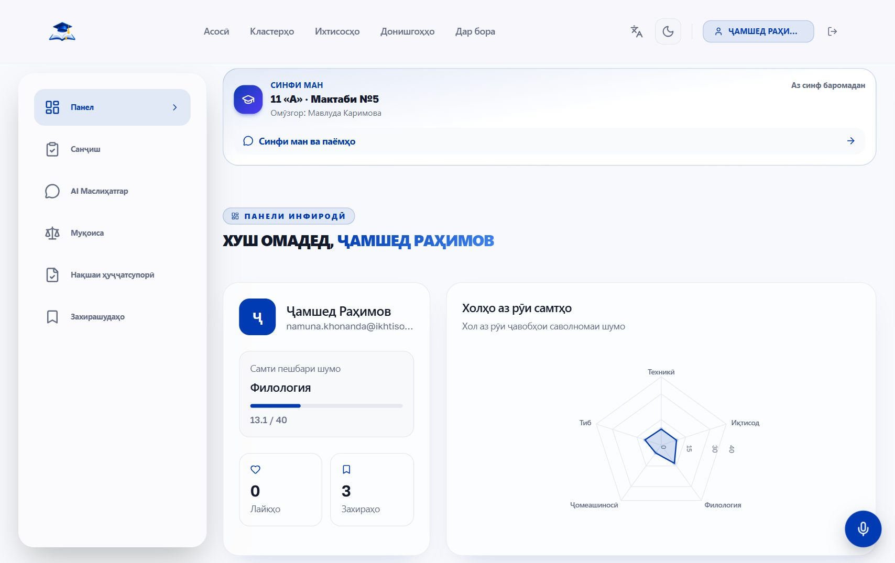

Ҳамаи абзорҳо дар як ҷо: натиҷаи тест, маслиҳатчии AI, муқоиса, нақшаи ҳуҷҷатсупорӣ, захираҳо ва синф.

### 3.2. Маслиҳатчии AI

Чат бо AI дар бораи касб, ихтисос ва донишгоҳ. AI натиҷаи тести хонандаро медонад. Саволҳои тайёр ҳастанд, ва бо овоз пурсидан ҳам мумкин аст.

### 3.3. Муқоисаи ихтисосҳо
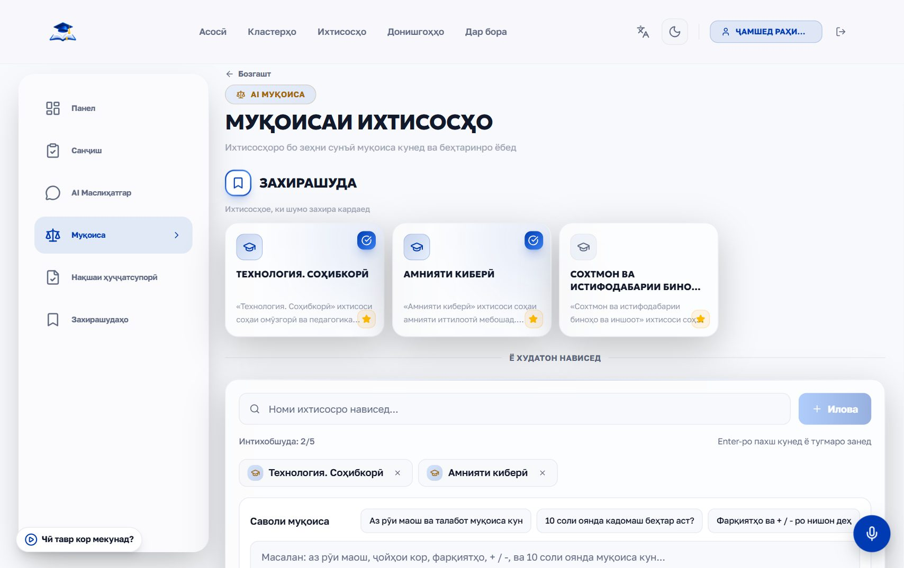

2–3 ихтисос паҳлӯ ба паҳлӯ муқоиса мешаванд: маош, ҷойҳои кор, таҳсил ва хулосаи AI.

### 3.4. Нақшаи ҳуҷҷатсупорӣ
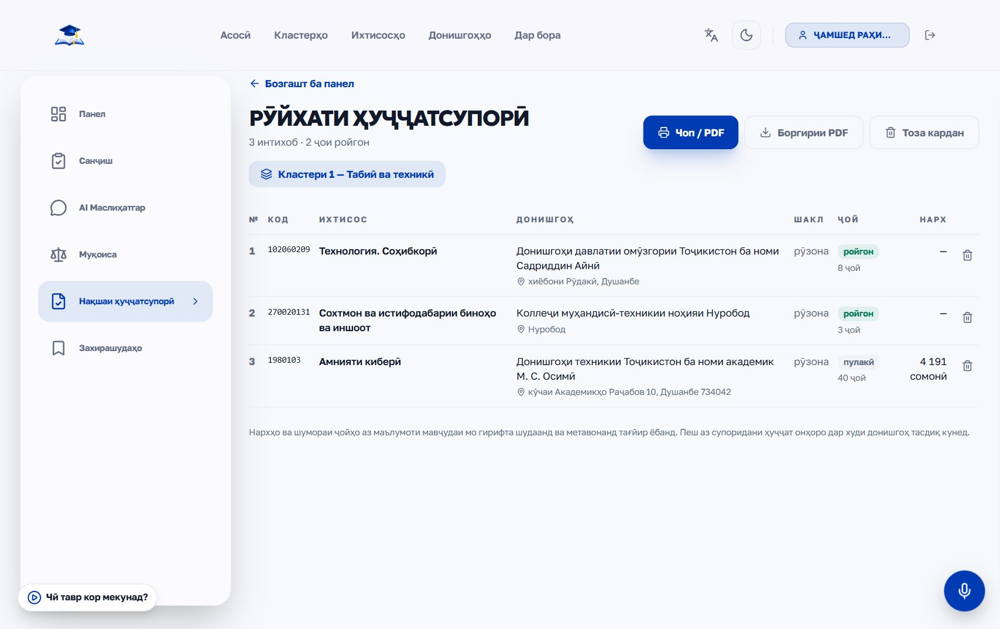

Рӯйхати интихобҳо барои ММТ: аввал ҷойҳои буҷетӣ, баъд пулакӣ. Ҳуҷҷат танҳо ба як кластер супорида мешавад ва то 12 интихоб иҷозат аст. Рӯйхатро ҳамчун **PDF** чоп кардан ва ба волидайн нишон додан мумкин аст.

### 3.5. Захирашудаҳо
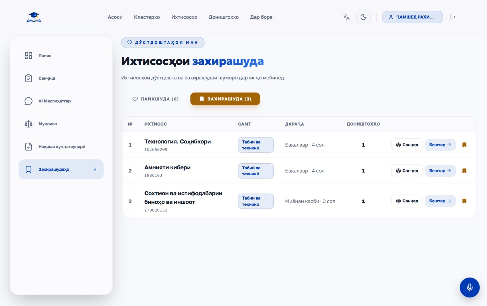

Ихтисосҳои захирашуда ва писандида дар як ҷадвал. Аз ҳамин ҷо касбро санҷидан ё саҳифаи ихтисосро кушодан мумкин аст.

### 3.6. «Синфи ман»

Агар хонанда ба синф ҳамроҳ шуда бошад, мебинад:
- ҳамсинфон кадом самтро гирифтаанд;
- **кадом ихтисосҳо дар синф маъмуланд**, бо нишонаи «шумо ҳам»;
- кадом касбҳоро санҷиданд.

Номҳо нишон дода намешаванд, чунки натиҷаи ҳар хонанда танҳо ба омӯзгор намоён аст.

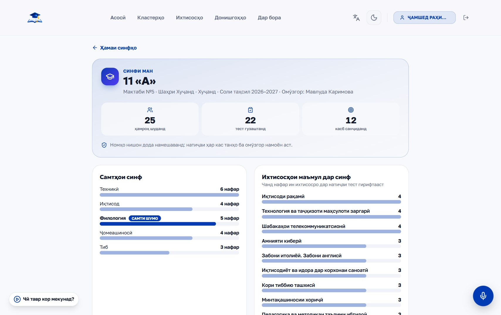

**Паёмҳо бо омӯзгорон:** фидбек ва маслиҳат, мисли чат. Ҳар омӯзгор бо номаш нишон дода мешавад.

---

## 4. Волидайн

### 4.1. «Волидайн ҳам бигӯянд»
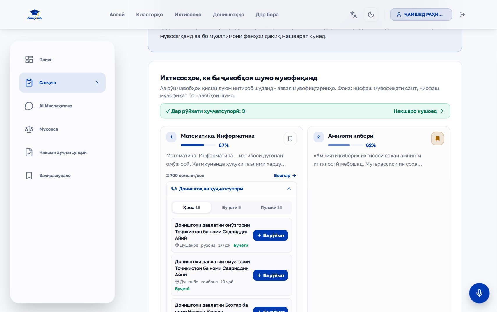

Хонанда дар натиҷаи тест **пайванд барои падар ё модар** месозад ва онро ба Telegram ё WhatsApp мефиристад.

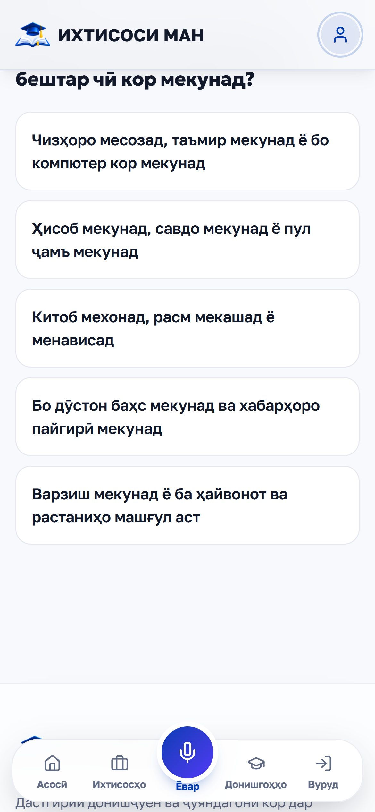

Волид бе бақайдгирӣ ба **10 саволи кӯтоҳ** дар бораи фарзандаш ҷавоб медиҳад, масалан «дар вақти холӣ чӣ кор мекунад?». Охирин савол ин аст: «шумо барои ӯ кадом самтро мехоҳед?». Натиҷаи фарзанд то ҷавоб додан ба волид нишон дода намешавад, то ӯ фикри худашро гӯяд.

### 4.2. Муқоиса: тест ↔ фикри волидайн

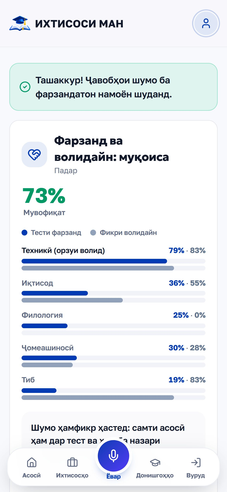

Ҳарду тараф муқоисаро мебинанд:
- **фоизи мувофиқат**;
- ҳар самт дар ду хат: тест ва фикри волид;
- орзуи волид;
- маслиҳатҳо барои гуфтугӯи оилавӣ.

### 4.3. Ихтисосҳои фарзанд ва саволҳо ба AI

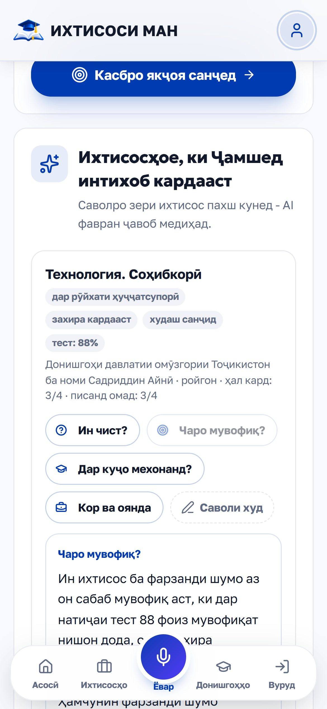

- Волид мебинад, ки фарзанд чӣ интихоб кардааст: аз натиҷаи тест, ихтисосҳои захирашуда, рӯйхати ҳуҷҷатсупорӣ ва касбҳое, ки худаш санҷидааст.
- Зери ҳар ихтисос 4 савол ҳаст: **«Ин чист?», «Чаро мувофиқ?», «Дар куҷо мехонанд?», «Кор ва оянда»**. Саволи худро навиштан ҳам мумкин аст.
- AI бо як пахш ҷавоб медиҳад ва натиҷаи тести фарзанд ва фикри худи волидро ба назар мегирад.

---

## 5. Омӯзгор ва мактаб

### 5.1. Ҳуҷраи омӯзгор
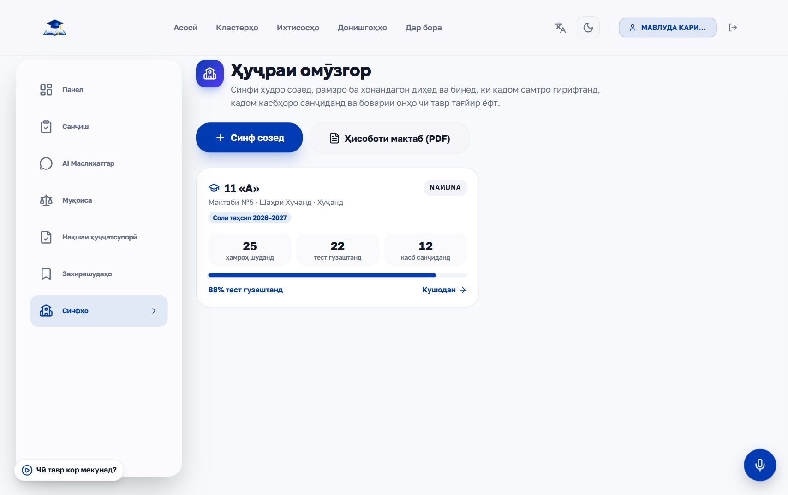

**Чӣ тавр омӯзгор мешаванд:**
- корбар дархост мефиристад: ному насаб, телефон, мактаб, роҳбари кадом синф аст, ва директор ё котибаи мактаб бо телефон;
- админ дар давоми 1 рӯз занг мезанад ва тасдиқ мекунад.

**Синф сохтан:** ном, мактаб, ноҳия, шаҳр ва **соли таҳсил**. Баъди тамом шудани соли таҳсил синф худкор ба бойгонӣ меравад.

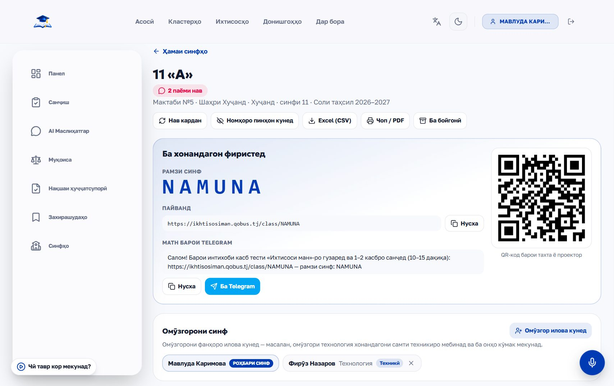

- **Рамз, пайванд ва QR** барои хонандагон. Матни тайёр барои гурӯҳи Telegram ҳам ҳаст.
- Хонанда **бе почта** ҳамроҳ мешавад, танҳо бо ном.

### 5.2. Омори синф

- **Пешрафт:** чанд нафар ҳамроҳ шуданд, тест гузаштанд ва касб санҷиданд.
- **Самтҳои синф:** самтро пахш кунед ва танҳо хонандагони ҳамон самт нишон дода мешаванд.
- **Боварӣ ба интихоб:** пеш ва баъди санҷиши касб (масалан 2.6 → 3.8). Ин таъсири воқеии лоиҳа аст.
- Филтрҳо: «тест нагузаштаанд» ва «касб насанҷидаанд», бо матни тайёри ёдраскунӣ.
- **Excel (CSV)**, чоп ва «номҳоро пинҳон кунед» барои намоиш дар экран.

### 5.3. Фидбеки омӯзгор (чат) ва омори пурраи хонанда
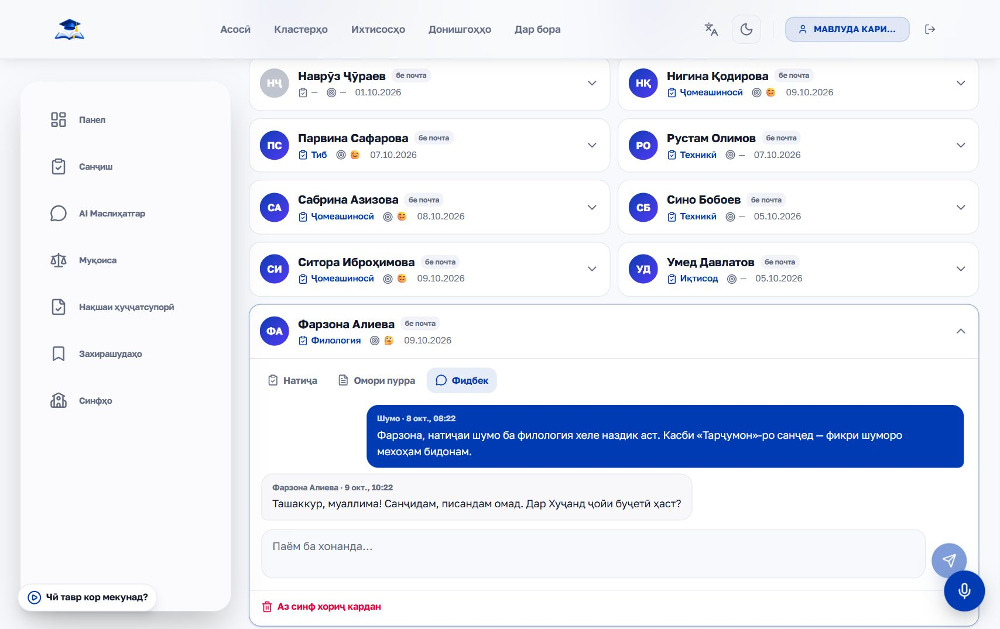

Корти ҳар хонанда се ҷадвал дорад:
- **Натиҷа:** панҷ самт, ихтисосҳо ва санҷишҳо.
- **Омори пурра:**
  - чанд бор тест гузашт;
  - тести аввал ва охир;
  - ихтисосҳои захирашуда;
  - рӯйхати ҳуҷҷатсупорӣ;
  - фаъолияти охирин.
- **Фидбек:** омӯзгор паём менависад ва хонанда дар «Синфи ман» ҷавоб медиҳад. Паёмҳои нав бо рақами сурх нишон дода мешаванд.

### 5.4. Омӯзгорони ёрирасон
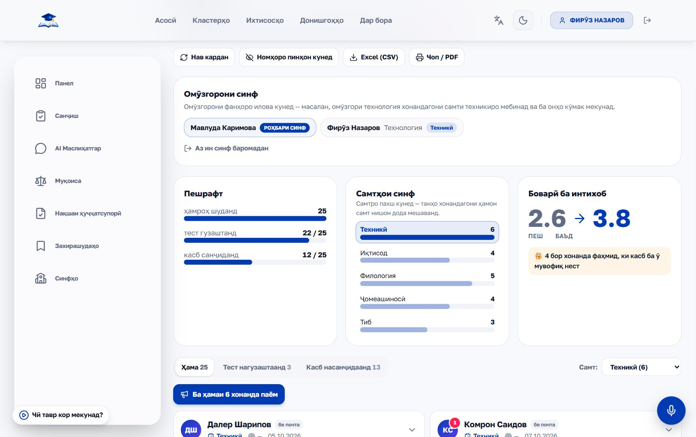

- Роҳбари синф **омӯзгори фанниро** илова мекунад, масалан омӯзгори технология, ва самти ӯро интихоб мекунад.
- Омӯзгори технология синфро фавран бо филтри **«Самт: Техникӣ»** мебинад.
- Бо тугмаи **«Ба ҳамаи 7 хонанда паём»** як паём ба ҳамаашон меравад.
- Ёрирасон синфро нест карда наметавонад, ба бойгонӣ гузошта наметавонад ва хонандаро хориҷ карда наметавонад.

### 5.5. Ҳисоботи мактаб (PDF)
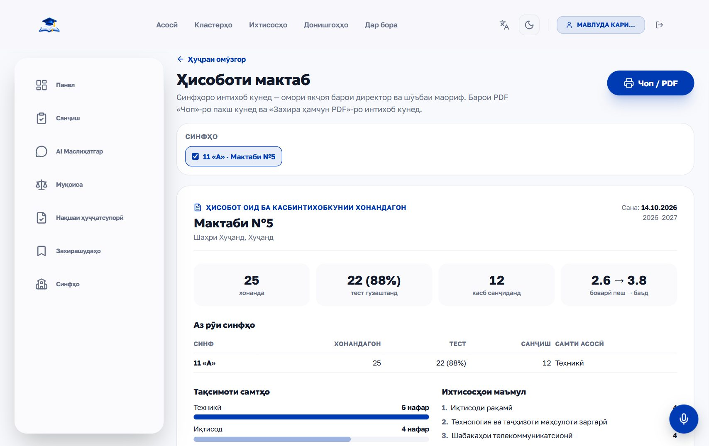

- Омӯзгор синфҳоро интихоб мекунад ва ҳисоботи якҷоя мегирад:
  - рақамҳо;
  - ҷадвали синфҳо;
  - тақсимоти самтҳо;
  - 10 ихтисоси маъмул;
  - хулоса.
- Ҷой барои **имзои омӯзгор ва директор** ҳаст.
- «Чоп / PDF» як саҳифаи A4 барои шӯъбаи маориф медиҳад.

### 5.6. Синфи намоишӣ барои ҳакамон
Синфи «11 «А»», рамз `NAMUNA`: 25 хонанда бо натиҷаҳои гуногун, санҷишҳо ва паёмҳо. Роҳбари синф, омӯзгори технология ва хонанда ҳисоб доранд, ва як волид аллакай ҷавоб додааст. Синфро бо скрипти `Back/nest-backend/scripts/seed-demo-class.js` аз нав сохтан мумкин аст.

---

## 6. Барои ҳама: AI, овоз, видео

### 6.1. Ёвари овозӣ

- Тугмаи микрофон дар ҳамаи саҳифаҳо ҳаст. Хонанда бо овоз мепурсад, масалан «ихтисосҳои табибиро нишон деҳ», ва ёвар саҳифаи лозимиро худаш мекушояд.
- **Овози тоҷикии модели худи лоиҳа** истифода мешавад; барои русӣ ва англисӣ модели алоҳида ҳаст.
- Тестро ҳам бо ёвар гузаштан мумкин аст.

### 6.2. Видеоҳои омӯзишӣ
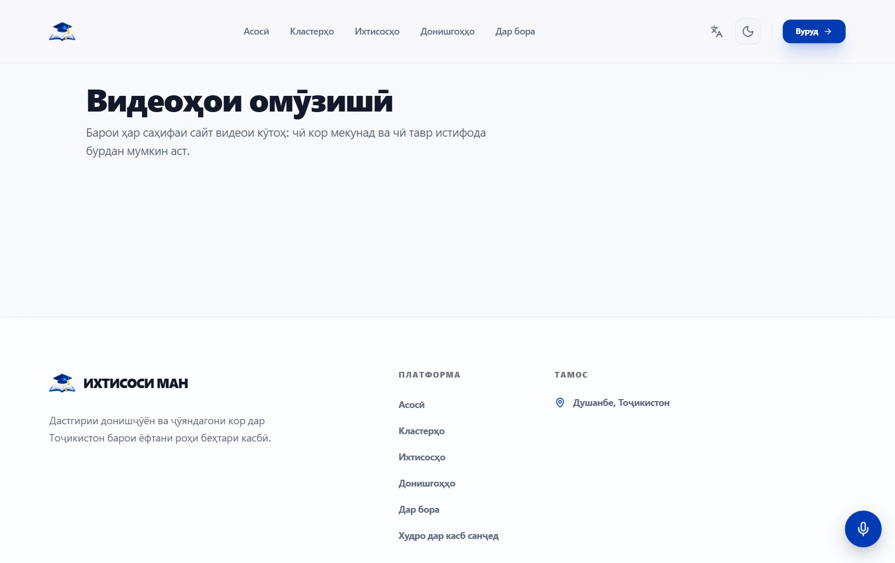

- **102 видео:** 17 мавзӯъ × 3 забон, алоҳида барои компютер ва телефон.
- Сабти воқеии экран бо овози модел. Камера ба ҷои амал зум мекунад, гирди тугма чорчӯба пайдо мешавад ва дар болои экран дастури кӯтоҳи ҳар қадам навишта мешавад.
- Тугмаи **«Чӣ тавр кор мекунад?»** дар ҳар саҳифа видеои ҳамон саҳифаро нишон медиҳад. Ҳамаи видеоҳо дар `/help` ҳастанд.

### 6.3. Се забон, реҷаи торик, телефон
- Ҳамаи матнҳо бо забонҳои тоҷикӣ, русӣ ва англисӣ. Ҷустуҷӯ номҳоро бо ҳар се забон меёбад.
- Реҷаи равшан ва торик.
- Ҳамаи саҳифаҳо барои телефон сохта шудаанд ва панели поёнӣ доранд.

---

## 7. Чаро ин лоиҳа фарқ дорад

1. **Маълумоти расмӣ:** 884 ихтисоси ММТ ва 23 307 холи гузариши воқеӣ, на рӯйхати умумии касбҳо.
2. **Касбро санҷидан, на танҳо хондан:** 884 рӯзи корӣ ва вазифаҳои воқеӣ.
3. **Таъсир ченак дорад:** боварии хонанда пеш ва баъди санҷиш (масалан 2.6 → 3.8).
4. **Оила дар интихоб иштирок мекунад:** волидайн, муқоиса ва саволҳо ба AI.
5. **Мактаб:** синф бо рамз, хонандагони бе почта, омӯзгорони ёрирасон, фидбек ва ҳисобот барои шӯъбаи маориф.
6. **Фарогирӣ:** тести пурраи овозӣ барои нобиноён ва овози тоҷикии худи лоиҳа.
7. **Махфият:** омори синф ва 360° бе номҳо; матни «Чаро ин касб?» нигоҳ дошта намешавад.
8. **Ростқавлӣ:**
   - AI маош ва ширкатҳоро аз худ намесозад;
   - «2035» ҳамчун пешгӯӣ навишта шудааст, на факт;
   - «Касб-свайп» ҳамчун бозӣ, на ташхис.
